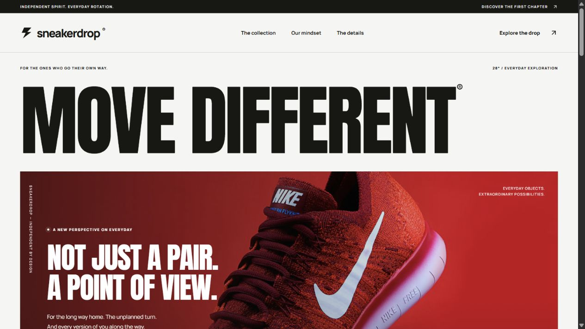
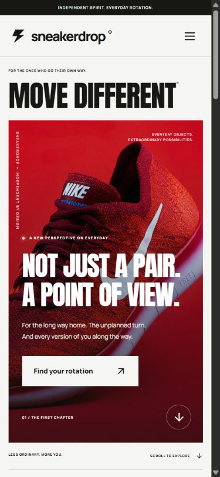
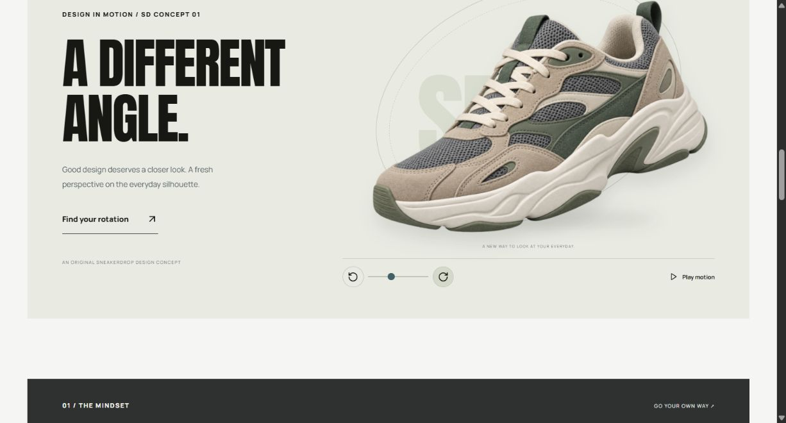
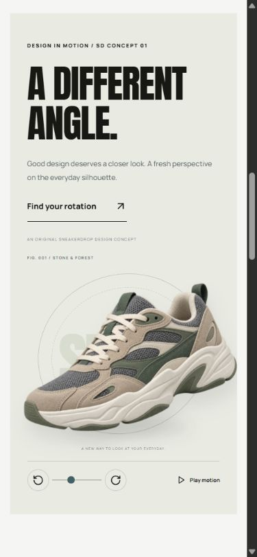
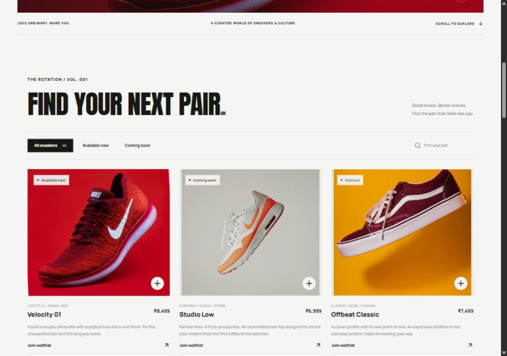
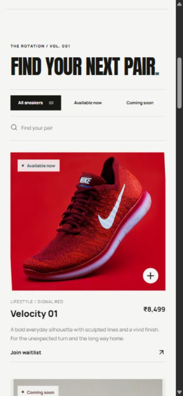
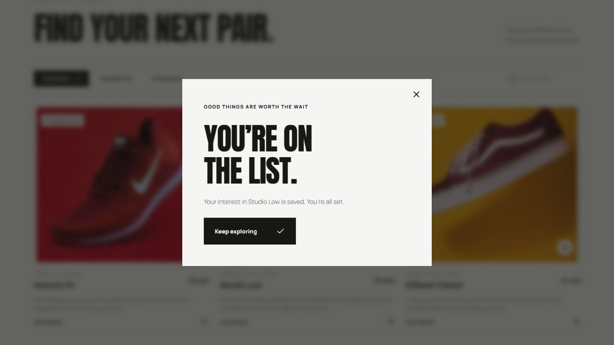

# SneakerDrop — Move Different.

A premium, responsive sneaker showcase for a fictional independent footwear brand. Photography-led editorial design, bold Anton headlines, Manrope typography, warm off-white, forest charcoal, stone, slate and muted teal.

## Project status

Connected to real Supabase PostgreSQL and Supabase Auth in the owner's existing **Yoake83's Project**. SneakerDrop uses its own prefixed tables and private functions so it can coexist with the project's existing application. The catalogue reads three seeded sneakers from the database; there are no hardcoded product arrays or mock backend responses.

- Deployment: [Open SneakerDrop](https://sneakerdrop-studio.honeymorel2.chatgpt.site) — owner-private Sites access.
- Admin: [SneakerDrop Studio](https://sneakerdrop-studio.honeymorel2.chatgpt.site/admin).
- Public GitHub repository: [Yoake83/SneakerDrop](https://github.com/Yoake83/SneakerDrop).
- Local preview: `http://localhost:5173`.

## Features

- Responsive editorial homepage, reveal animations, moving typography, product image interactions, keyboard access and reduced-motion support.
- Original interactive sneaker concept: floating rotation, pointer tilt, manual angle controls and pause/play. Automatic motion pauses offscreen and when the tab is hidden. This animates a transparent 2D image, not a full 360-degree model.
- Database-backed catalogue with availability filters, search, product details, description, HTTPS imagery and INR pricing.
- Product-specific waitlists with email validation, normalization, real persistence and atomic duplicate prevention.
- Supabase email/password authentication; only a database-allowlisted user can enter the studio or modify products.
- Admin product creation, editing, availability updates and deletion; waitlist submissions view and CSV export.
- Explicit loading, error, empty and success states; accessible native dialogs and focus return.

## Stack

React 19, Vite, CSS, Lucide icons, Supabase JavaScript SDK, Supabase PostgreSQL and Supabase Auth. The Supabase SDK is pinned and the npm lockfile is committed. Node.js 22+ recommended.

## Local setup

```sh
npm ci
cp .env.example .env
npm run dev
```

PowerShell can use `Copy-Item .env.example .env`.

Set these values in your ignored `.env`:

```dotenv
VITE_SUPABASE_URL=https://YOUR_PROJECT.supabase.co
VITE_SUPABASE_PUBLISHABLE_KEY=YOUR_PUBLISHABLE_KEY
```

Use the project's Connect dialog, or Settings → API Keys, to retrieve public client settings. Only the publishable key belongs in the browser. Never place a service-role key, secret key, database password or admin password in a `VITE_` variable. Vite embeds those variables in the public bundle. Rebuild after changes.

## Database setup

The current connected project is already configured. For a fresh installation:

1. Run `supabase/schema.sql` once in the Supabase SQL Editor. It creates a private helper schema, three prefixed tables, explicit grants, RLS policies, database validation, public RPC wrappers and a timestamp trigger.
2. Run `supabase/seed.sql`. It adds three fictional sneakers using stable IDs and can safely be re-run.
3. In Authentication → Users, create your admin user and set the password yourself.
4. Authorize that exact account using the SQL Editor:

```sql
insert into public.sneakerdrop_admin_users(user_id)
select id from auth.users where lower(email) = 'YOUR_ADMIN_EMAIL'
on conflict (user_id) do nothing;
```

5. Configure local and deployment build variables; restart or rebuild the app.
6. Open `/admin` and sign in. There is no public registration UI or default password.

The current owner-selected admin is `test@gmail.com`; its password is managed through Supabase and is not stored in the repository. For a shared Supabase project, retain the other application's Auth settings, users, tables, policies and functions. This installation does not change global sign-up or redirect configuration. Password sign-in does not need a callback route.

### Schema

| Object | Purpose | Access |
| --- | --- | --- |
| `public.sneakerdrop_products` | UUID, name, description, INR price, image URL, category, colourway, availability, timestamps | Public SELECT; allowlisted admins may INSERT, UPDATE and DELETE |
| `public.sneakerdrop_waitlist` | UUID, product foreign key, normalized email, creation time; unique product/email | Admin-only SELECT; constrained RPC is the only visitor write path |
| `public.sneakerdrop_admin_users` | UUID referencing an Auth user | No direct client grants; RLS default-deny |
| `sneakerdrop_private` | Privileged membership and waitlist helpers; update trigger | Not a Data API exposed schema |
| `public.sneakerdrop_is_admin()` | Current-user membership check | Invoker wrapper around private helper |
| `public.sneakerdrop_join_waitlist(uuid,text)` | Validated, duplicate-safe signup | Invoker wrapper around narrow private write helper |

Deleting a product cascades to its waitlist rows; the studio explains and confirms that consequence.

## Architecture and technical decisions

```text
React browser app
 ├─ Catalogue ────────────────── Supabase Data API ─ products (public SELECT)
 ├─ Interest form ────────────── public RPC wrapper ─ private validated waitlist insert
 └─ Studio ── Supabase Auth ──── user JWT + RLS ───── products CRUD / waitlist SELECT
                                          └──────── private admin membership check
```

Supabase supplies the real backend: Auth issues sessions, the Data API applies grants and RLS, and PostgreSQL is the source of truth. A separate Node API is unnecessary for these operations. Client route checks are for UX; removing them cannot grant database writes or disclose waitlist emails.

Privileged functions have fixed empty search paths, fully qualified objects and explicitly limited execution grants. The admin helper checks `auth.uid()` against a server-controlled allowlist. Public wrappers use invoker permissions. The deliberately anonymous waitlist endpoint can only validate and insert product interest; it cannot read, edit or delete stored entries. Existing and new email/product pairs return the same success response, avoiding email enumeration. A unique constraint handles concurrent duplicates atomically.

The public catalogue reloads on visibility changes and every 60 seconds. Admin mutations refresh studio data immediately. No Realtime publication is required. Marketing artwork is separate from catalogue records.

## Validation

```sh
npm test
npm run build
node --env-file=.env scripts/check-supabase.mjs
```

Four unit tests cover email normalization/validation, HTTPS image protocols, price limits and availability values. Production builds pass.

Live HTTP checks verified that three products are publicly readable and anonymous reads of waitlist and admin membership tables are denied. All rollback-only SQL acceptance assertions passed: anonymous/non-admin restrictions, normalized duplicate prevention, admin CRUD, waitlist reads, validation and cascade deletion. The script is saved as `supabase/acceptance.sql`; it references the configured `test@gmail.com` administrator, so adapt that email for another installation. A real browser submission also reached the success state, and submitting the same address with different casing reached the same safe success response.

Browser checks cover desktop/mobile layouts, catalogue navigation, filters, product details, waitlist form feedback and the shoe-motion controls. Admin password entry remains with the owner; no password is captured in tests or source.

## Deployment

### Sites

`.openai/hosting.json` identifies the existing Site and `dist` output. Source is committed and pushed through the Sites workflow, then the exact production build is packaged and published. The current static build embeds only public Supabase settings. Runtime environment variables alone cannot change a previously built Vite bundle; configure build variables and rebuild.

The Site currently has owner-private access. A public submission needs public audience access or a public Vercel/Netlify deployment.

### Vercel / public GitHub submission

1. Push this folder to a public GitHub repository, excluding `.env`, `node_modules` and `dist`.
2. Import the repository in Vercel: Vite preset, `npm run build`, output `dist`.
3. Set both public `VITE_SUPABASE_*` build variables and deploy.
4. `vercel.json` rewrites `/admin` to the app entry and provides basic response headers.
5. Record the verified public deployment and repository URLs here.

Netlify uses the same build/output settings; `public/_redirects` supports the admin route.

## Screenshots






Earlier homepage screenshots predate the database connection. Connected catalogue and real waitlist success:





## Known limitations

- No checkout, payments, shipping, sizes/stock counts, automated waitlist emails or release notifications. Waitlists record interest only.
- No server-side bot challenge or per-IP rate limiting for waitlist RPC calls. Add an edge endpoint and verified challenge before a high-traffic launch.
- Images use HTTPS URLs rather than admin uploads; third-party images can become unavailable.
- Supabase sessions use the SDK's browser storage. A higher-assurance admin can adopt HttpOnly cookie sessions and MFA.
- Some product photography depicts existing brands and is illustrative. Replace with owned product photography for commercial use.
- The connected shared project already had security advisor warnings for an existing function's [mutable search path](https://supabase.com/docs/guides/database/database-linter?lint=0011_function_search_path_mutable), an existing [extension in public](https://supabase.com/docs/guides/database/database-linter?lint=0014_extension_in_public), and disabled [leaked-password protection](https://supabase.com/docs/guides/auth/password-security#password-strength-and-leaked-password-protection). These global/unrelated settings were preserved.
- The admin-membership table's no-policy advisor INFO is intentional default-deny; it has no direct client grants and membership is checked through a private, identity-aware helper.
- Vercel deployment is being configured; the earlier Sites deployment has owner-private access.
- Legal/privacy copy, retention processes and a commercial deletion-request workflow require actual business details.

## Assets and references

- Fonts: Anton and Manrope, via Google Fonts.
- Icons: Lucide.
- Photography: Unsplash. Source URLs are in `supabase/seed.sql` and `src/main.jsx`; story/detail images are bundled locally.
- The original motion shoe was created with the built-in image-generation tool; asset and exact prompt are documented in `docs/motion-art-direction.md`.
- Design reference: [Icebug on Landbook](https://land-book.com/websites/98076-vercel-security-checkpoint). Original SneakerDrop composition and copy.
- Backend references: [RLS](https://supabase.com/docs/guides/database/postgres/row-level-security), [functions](https://supabase.com/docs/guides/database/functions), [API keys](https://supabase.com/docs/guides/api/api-keys).
